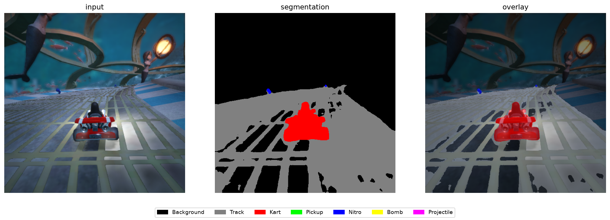
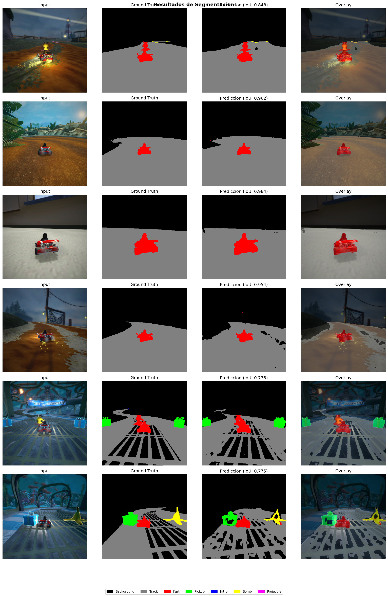
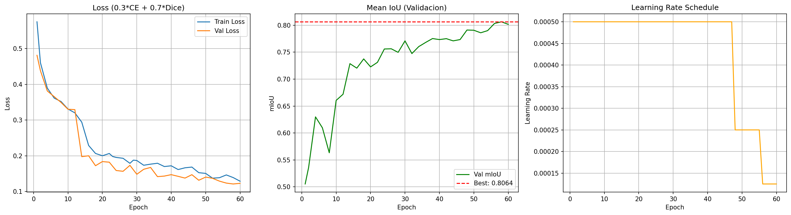

# SuperTuxKart Semantic Segmentation with a Frozen SAM 2 Encoder

Pixel-level segmentation of 7 game classes by freezing Meta's SAM 2 Hiera-Tiny vision
encoder and training only a 2.1M-parameter multi-scale decoder on top of it —
**7% of the network is trainable** and it reaches **mIoU 0.8534** on the validation split
in 60 epochs.



<sub>Produced by `python -m stkseg.predict docs/assets/examples/abyss_frame_0100.png`.</sub>

---

## Why this is interesting

The usual transfer-learning recipe fine-tunes a backbone. Here the backbone never
receives a gradient: SAM 2 already knows what an *object boundary* looks like, so the
only thing worth learning is how to map its FPN features onto a 7-class taxonomy that
SAM 2 has never seen. That makes training cheap, keeps the checkpoint small
(**8 MB**, decoder only — the encoder is pulled from Hugging Face at load time), and
isolates a clean question: *how far do frozen foundation-model features get you?*

The answer, on this dataset: far enough to beat a U-Net trained from scratch on the
same frames (mIoU 0.83) while training 25× fewer parameters.

| | U-Net from scratch | **SAM 2 + decoder (this repo)** |
|---|---|---|
| Trainable params | ~1.2M (100%) | **2.1M (7.2% of 29.3M)** |
| Epochs | 80 | **60** |
| Validation mIoU | 0.830 | **0.8534** |

## Results

Dataset-level IoU over the untouched 20% validation split:

| Class | IoU | Pixel share |
|---|---|---|
| Background | 0.9102 | ~55% |
| Track | 0.9044 | ~38% |
| Kart | **0.9156** | ~5% |
| Pickup | 0.8594 | <1% |
| Nitro | 0.8037 | <0.5% |
| Bomb | 0.7269 | <0.5% |
| Projectile | **0.0000** | 2 frames out of 1500 |
| **mean** | **0.8534** | |

Two things worth reading honestly:

- **Kart scores highest (0.9156) despite being a minority class.** It is a large object
  with a crisp silhouette — exactly the prior SAM 2 was pre-trained on. The frozen
  encoder is doing the heavy lifting.
- **Projectile is 0.0000 and no amount of rebalancing fixes it.** It appears in 2 of
  1500 frames. Oversampling, a 15× loss weight and Dice all failed, because the problem
  is the absence of data, not the objective. Reporting it as a zero rather than dropping
  the class from the mean is the point.





The mIoU plateau between epochs 14–46 is a learning-rate artifact: at `5e-4` the
optimizer oscillates around the minimum. `ReduceLROnPlateau` cut it to `2.5e-4` at
epoch 47 and `1.25e-4` at epoch 55, which is where the final 0.80 → 0.8534 gain comes
from. A cosine schedule would likely get there sooner.

## Architecture

```
input 512×512×3
        │
        ▼
┌───────────────────────────────┐
│ SAM 2 Hiera-Tiny vision enc.  │  27.2M params — FROZEN, always in eval()
└───────────────────────────────┘
        │  FPN hidden states (256 ch each)
        ├── 128×128  ──┐
        ├──  64×64   ──┤  bilinear resample to 128×128
        └──  32×32   ──┘
                       ▼
            concat 384 ch → fuse (3×3, BN, ReLU, Dropout 0.1) → 128 ch
                       ▼
                 Conv 1×1 → 7 logits @128×128
                       ▼
            bilinear upsample → 512×512×7     2.1M params — TRAINABLE
```

Design notes:

- The encoder stays in `eval()` even during `model.train()` — otherwise its BatchNorm
  running statistics drift and the "frozen" claim quietly becomes false.
- All three FPN levels are projected to the *highest* resolution rather than
  progressively upsampled: small classes (Nitro, Bomb) live in a handful of pixels and
  lose too much in a cascade.
- Masks are always resized with `NEAREST`. Bilinear interpolation on a label map invents
  class ids that do not exist.

## Handling a 200:1 class imbalance

Background and Track cover >90% of pixels. Without compensation the model collapses to
predicting those two. Three mechanisms stack:

1. **Oversampling** — `WeightedRandomSampler` gives frames containing Nitro/Bomb/Projectile
   5× selection probability (536 of 1200 training frames qualify).
2. **Weighted cross-entropy** — inverse-frequency weights from 0.5 (Background) to 15.0
   (Projectile).
3. **Dice loss at 70%** — computed per class over the batch, so a class covering 0.1% of
   pixels contributes as much to the gradient as the background does. This is what
   actually moves the rare classes; the CE weights alone were not enough.

## Quickstart

```bash
git clone https://github.com/<user>/sam2-supertuxkart-segmentation
cd sam2-supertuxkart-segmentation
pip install -e ".[app,dev]"
```

Run the interactive demo (downloads the SAM 2 encoder on first launch):

```bash
make app            # http://localhost:7860
# or, fully containerised:
docker compose up --build
```

Train from scratch:

```bash
python -m stkseg.train --config configs/default.yaml --data-root seg_dataset
python -m stkseg.evaluate --checkpoint runs/baseline/decoder_best.pt
python -m stkseg.predict path/to/frame.png --out prediction.png
```

Every hyperparameter lives in [`configs/default.yaml`](configs/default.yaml); the
values committed there are the ones that produced the numbers above.

## Dataset and weights

Neither is in the repo. The dataset is 1500 frame/mask pairs (400×400 RGB) exported
from [`pystk`](https://github.com/philkr/pystk), the Python binding to the SuperTuxKart
engine, which gives exact pixel-level ground truth:

```
seg_dataset/
  images/abyss_frame_0128.png
  masks/abyss_mask_combined_0128.png   # uint8, values 0–6
```

The trained decoder ships as a GitHub release artifact. To regenerate it from a full
checkpoint that still contains the encoder:

```bash
python scripts/extract_decoder.py model.th runs/baseline/decoder_best.pt
# 117 MB -> 8 MB
```

## Layout

```
src/stkseg/
  constants.py   class names, palette, device selection
  config.py      dataclass config loaded from YAML
  data.py        dataset, augmentation, oversampled dataloaders
  model.py       SegmentationDecoder + SAM2Segmenter
  losses.py      Dice and the CE/Dice blend
  metrics.py     IoU per class and mean IoU
  viz.py         colourised masks, overlays, curve plots
  train.py       training CLI
  evaluate.py    evaluation CLI, writes metrics.json
  predict.py     single-image CLI
app/app.py       Gradio demo
scripts/         decoder extraction
tests/           pytest suite (metrics, losses, decoder shapes)
notebooks/       the original coursework notebook, unmodified
docs/assets/     figures and the full Spanish report (PDF)
```

## Limitations

- Validation mIoU is reported, not a held-out test split — the coursework used an 80/20
  train/val split only. Treat 0.8534 as a validation figure.
- Batch size is pinned at 4 by encoder activation memory at 512×512. Gradient
  accumulation would allow a larger effective batch.
- Only Hiera-Tiny was tried. Hiera-Small/Base would test whether the gains come from
  encoder capacity or from the decoder design.
- Single seed. No variance estimate on the reported mIoU.

## Reference

Built for the Computer Vision course of the MSc in Artificial Intelligence,
Universidad San Francisco de Quito. The full methodology write-up (Spanish) is in
[`docs/assets/report_es.pdf`](docs/assets/report_es.pdf).

- Ravi et al., *SAM 2: Segment Anything in Images and Videos* (2024)
- Lin et al., *Feature Pyramid Networks for Object Detection* (2017)
- Milletari et al., *V-Net: Fully Convolutional Neural Networks for Volumetric Medical Image Segmentation* (2016)

MIT licensed.
