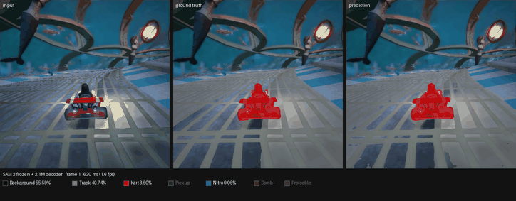
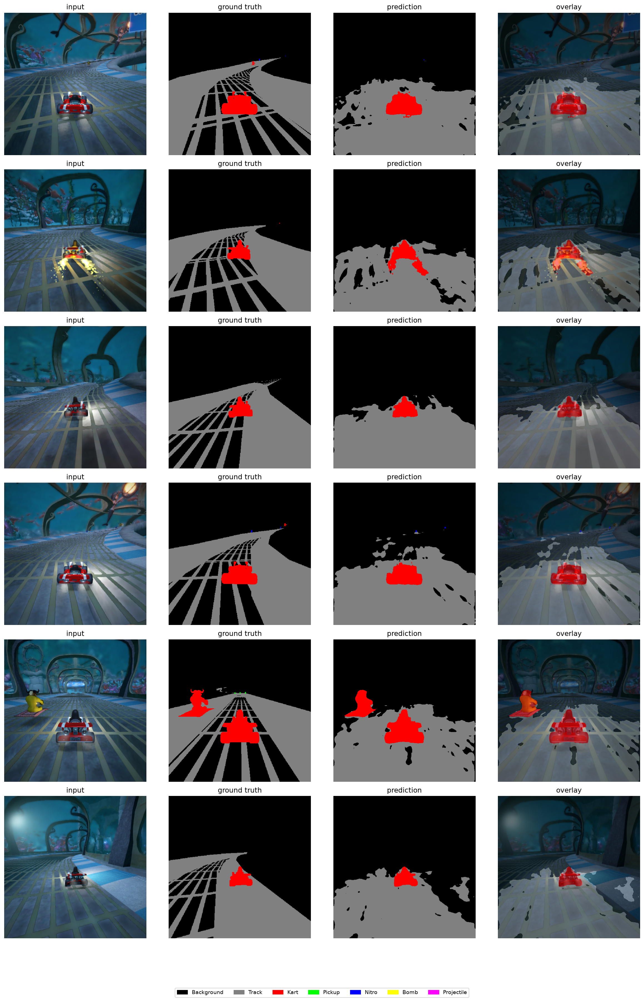
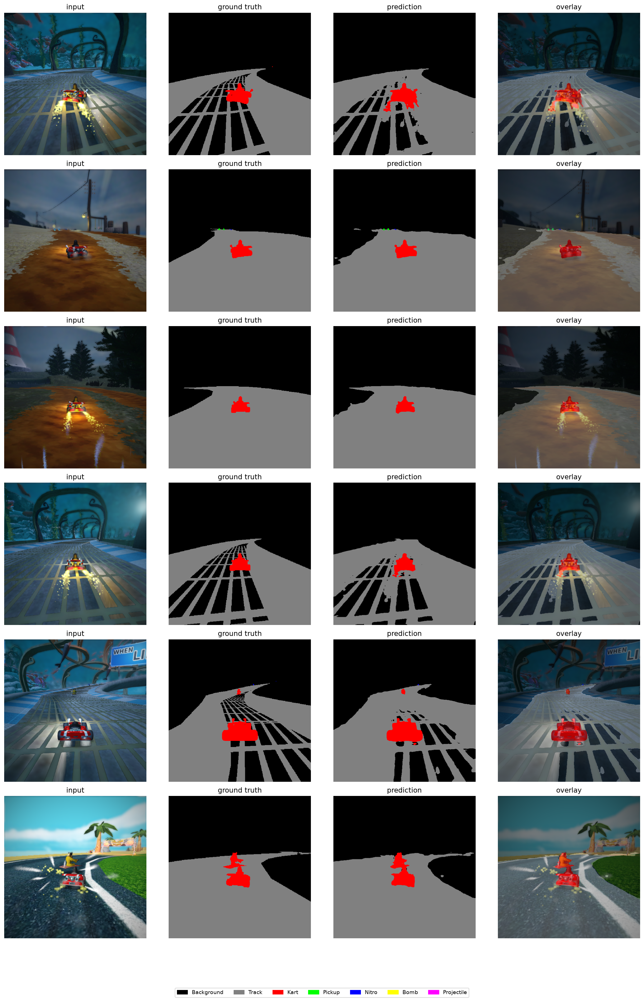
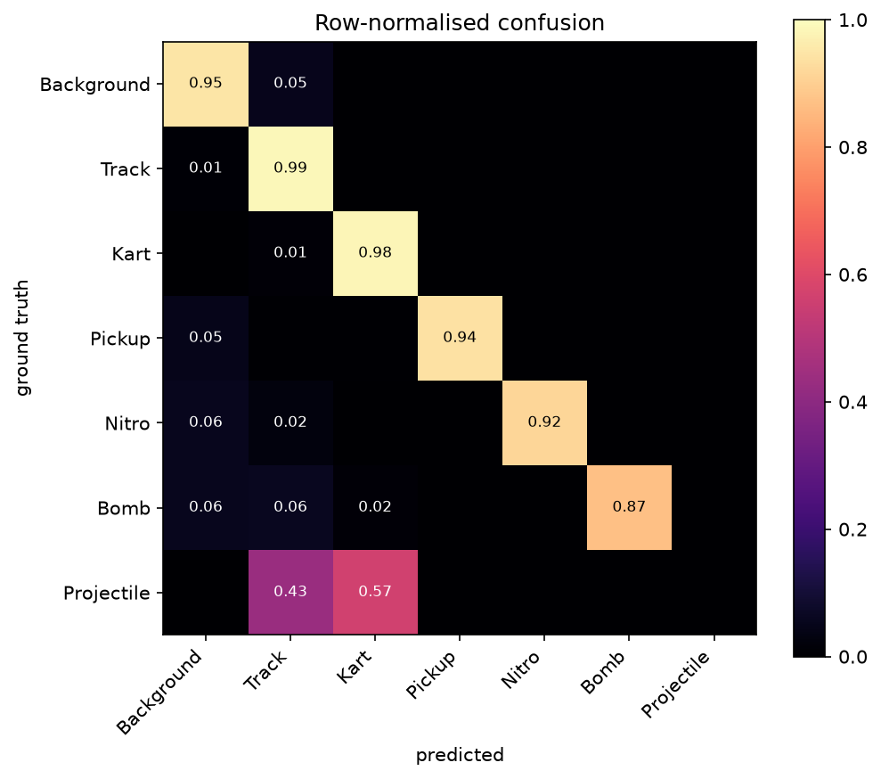
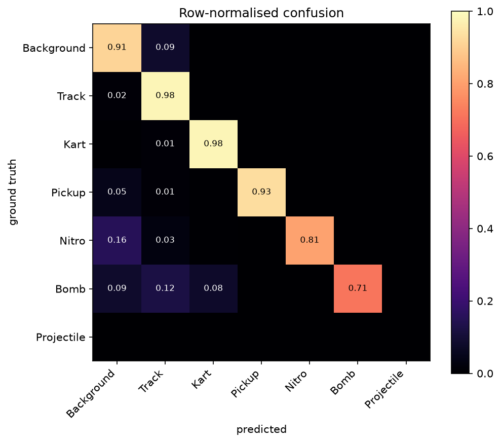
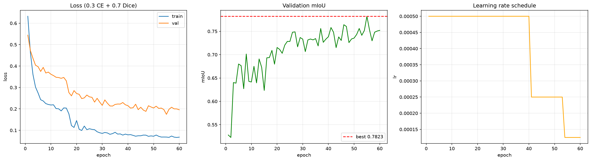

# SuperTuxKart Semantic Segmentation with a Frozen SAM 2 Encoder

[](https://github.com/PabloAndresE/sam2-supertuxkart-segmentation/actions/workflows/ci.yml)
[](LICENSE)
[](MODEL_CARD.md)
[](https://colab.research.google.com/github/PabloAndresE/sam2-supertuxkart-segmentation/blob/main/notebooks/demo_colab.ipynb)

Meta's SAM 2 Hiera-Tiny encoder is frozen; only a 2.1M-parameter decoder trains — **7% of
the network**, shipped as an **8 MB** checkpoint. 38 training runs on H200s measure what
that is worth, and what the original score actually meant.



### What the experiments found

- **A selection score overstated generalisation by 0.117.** Picking the checkpoint by
  validation mIoU and reporting that same number — what the original coursework did —
  claimed 0.8897 where the held-out test split gives **0.7731**.
- **The leakage hypothesis was wrong.** A random split puts 691 adjacent video frames
  across the train/validation boundary, which *should* inflate the score. On the same
  classes it did not: 0.8630 random versus 0.8897 leak-free. Recorded as rejected.
- **Unseen scenery costs 0.157 ± 0.090**, and *which* track is held out swings the result
  by 0.24 — **16× the noise from weight initialisation**, and larger than any modelling
  choice tested, including the backbone.
- **The flicker argument did not survive either.** Per-frame inference was expected to
  make predictions jitter across video frames. The engine's own masks change 13.51% of
  pixels between frames; the model's change 12.03%. It is *more* stable than the scene.

Each of those is a hypothesis that was measured and, in three cases, discarded. The
protocol that catches them — leakage-aware splits, a gated test set, ablations at matched
parameter budgets — is the actual subject of this repository.

## The question

The usual transfer-learning recipe fine-tunes a backbone. Here the backbone never
receives a gradient: SAM 2 already knows what an object boundary looks like, so the
only thing worth learning is how to map its FPN features onto a 7-class taxonomy it has
never seen. That isolates a clean question — **how far do frozen foundation-model
features get you, and does it have to be SAM 2?**

The repository is built to answer that with controlled comparisons rather than a single
number, which is why the evaluation protocol below gets more attention than the result.

## Evaluation protocol (read this before the numbers)

The dataset is **not 1500 independent images**. It is 6 tracks × 250 *consecutive frames*
from a race. Measured on `abyss`, a frame differs from its neighbour by a mean absolute
difference of **0.066**, versus **0.126** for frames more than 25 apart — neighbours are
about twice as similar as distant frames. They are not duplicates, but they are
correlated, and a uniformly random split puts that correlation on both sides of the
boundary.

Three split strategies are implemented in [`src/stkseg/splits.py`](src/stkseg/splits.py):

| Strategy | Adjacent frame pairs crossing a split | Tracks in val/test | Measures |
|---|---|---|---|
| `random` | **691** | all 6 (also in train) | optimistic; reproduces the original coursework number |
| `temporal_block` | **26** (block boundaries only) | 5 / 4 | generalisation to unseen moments of a known track |
| `track_holdout` | **0** | 1 / 1, disjoint from train | generalisation to **unseen scenery** |

`temporal_block` is the default. `track_holdout` is the honest hard setting: a random
split cannot answer the question "does this work on a track it has never seen" at all,
because every track appears in training.

Two further guarantees:

- **Three-way 70/15/15 split.** Model selection reads `val`. The original setup selected
  the best checkpoint by validation mIoU and then reported that same validation mIoU —
  a selection score, not a generalisation estimate.
- **The test split is gated.** `stkseg.evaluate --split test` refuses to run without
  `--confirm-final`, and every test evaluation is appended to
  `test_evaluations.jsonl` with its timestamp, strategy and seed. The gate is not
  tamper-proof; it exists to make a test read deliberate and auditable.

## Results

### Headline: the selection score overstated generalisation by 0.117

Same split (`temporal_block`, seed 42), same checkpoint, same six classes:

| Chosen model (SAM 2, frozen) | mIoU_shared6 |
|---|---|
| Validation — the score the checkpoint was selected on | 0.8897 |
| Test — read once, after selection | **0.7731** |
| **Gap** | **−0.117** |

This is the result the rest of the protocol exists to catch. Reporting the validation
score of a checkpoint chosen on that same validation set — what the original 0.8534 did
— would have overstated performance on unseen frames by 0.117. The test split was read
exactly once, on this model only (logged in
`runs/decisive/split_temporal_block/test_evaluations.jsonl`); the test value above is
that single read, which contains six classes. What the gap cannot tell apart is how much
is selection optimism and how much is a harder test set: the test split contains
`gran_paradiso_island`, which validation does not, and splitting the two would require
reading more test splits, which the protocol forbids.

### Setup and noise

Every run shares one protocol (`configs/server.yaml`: 512×512, 60 epochs, batch 16, AMP,
Adam 5e-4 with `ReduceLROnPlateau`) on NVIDIA H200s. Validation scores come from
`stkseg.evaluate` (dataset-level IoU), not the training loop. 38 training runs, all
completed: `decisive` (5), `seeds` (3), `seeds_backbones` (6), `ablations` (15), `loto`
(6), `init_seeds` (3), plus one discarded ConvNeXt run whose checkpoint was incomplete.

**Comparisons across runs use `mIoU_shared6`**, the mean over the six classes that are
normally present in every split (all but `Projectile`). The plain `mIoU` is kept beside
it unchanged; it averages whatever classes occur in a given split, so it is not
comparable across splits (see Metrics). All 29 earlier runs were re-evaluated to add the
column; their `mIoU` values reproduced exactly.

Three sources of noise, measured separately on SAM 2 (`mIoU_shared6`, mean ± sd):

| What varies | Runs | Spread |
|---|---|---|
| Nothing (same split, same init seed; GPU nondeterminism only) | 5 | 0.8881 ± 0.0022 |
| Initialisation (`init_seed` 42, 1, 2, 3; split fixed at seed 42) | 4 | 0.8882 ± 0.0056 |
| Which frames land in validation (`seed` 42, 1, 2, 3; split and init together) | 4 | 0.8521 ± 0.0305 |
| Which **track** is unseen (leave-one-track-out, 6 tracks) | 6 | 0.7325 ± 0.0897 |

Initialisation noise is small. The split is five times larger, and which track is held
out is three times larger again.

### Hypothesis rejected: neighbour-frame leakage did not inflate the score

The dataset is 6 tracks × 250 consecutive frames, and a `random` split puts 691 adjacent
frame pairs across the train/validation boundary versus 26 for `temporal_block`. The
working hypothesis was that this leakage inflated the legacy 0.8534. **It did not hold
up.** On the same six classes, `temporal_block` scored *higher* than `random`:

| Split | Adjacent pairs crossing | Val tracks | mIoU | mIoU_shared6 | Boundary mIoU |
|---|---|---|---|---|---|
| `random` | 691 | all 6 | 0.8630 | **0.8630** | 0.4262 |
| `temporal_block` | 26 | 5 | 0.7626 | **0.8897** | 0.3232 |

The 0.10 gap in the plain `mIoU` column runs the other way only because `Projectile`
(0.0000) happens to fall in the `temporal_block` validation set and not in `random`'s:
0.8897 × 6/7 = 0.7626. A rerun reproduced the ordering (0.8699 vs 0.8898). This is one
split seed and the validation sets differ in content, so the finding is "no inflation
detected", not "temporal_block is easier" — but the leakage explanation for 0.8534 is
not supported by these runs.

The legacy figure, from a different run under the old protocol, is not comparable to any
table here:

| Legacy (coursework protocol) | mIoU |
|---|---|
| `random` split, checkpoint selected and scored on the same validation set | 0.8534 |

### Unseen scenery: the real gap, and it depends heavily on the track

`configs/loto.yaml` holds out each track exactly once for validation (and the next one
for test, unread), training on the remaining four. SAM 2, seed 42:

| Unseen track (val) | mIoU | mIoU_shared6 | Boundary mIoU | Weakest classes | Gap to `temporal_block` 0.8897 |
|---|---|---|---|---|---|
| `lighthouse` | 0.8105 | 0.8105 | 0.2384 | Bomb 0.55 | −0.079 |
| `gran_paradiso_island` | 0.6749 | 0.7873 | 0.2085 | Bomb 0.48, Nitro 0.62 | −0.102 |
| `hacienda` † | 0.5586 | 0.7820 | 0.2030 | Pickup 0.56 | −0.108 |
| `olivermath` | 0.7584 | 0.7584 | 0.2481 | Nitro 0.54 | −0.131 |
| `abyss` | 0.6844 | 0.6844 | 0.1762 | Track 0.53, Background 0.67 | −0.205 |
| `volcano_island` | 0.4905 | 0.5723 | 0.1470 | Nitro 0.15, Bomb 0.44 | −0.317 |
| **mean ± sd** | | **0.7325 ± 0.0897** | 0.2035 ± 0.0378 | | **−0.157** |

† `hacienda` contains **no** `Bomb` in any of its 250 frames, and the model predicted
some. Scoring that as a missed class would charge the mean for a false positive, so
`mIoU_shared6` averages over the classes present in the ground truth — five for
`hacienda`, six elsewhere — and the invented class is reported separately in
`hallucinated_classes`. The denominator is a property of the split, not of the model's
mistakes. Ground-truth class presence was verified directly from the mask files.

What this says:

- **The single-track figure was one draw from a wide range.** The earlier "unseen scenery
  costs 0.20" came from `abyss` alone, which turns out to be the second-worst of the six.
  Across all tracks the cost runs from 0.08 (`lighthouse`) to 0.32 (`volcano_island`);
  the mean is 0.16. The track that happens to be held out moves the answer by 0.24 —
  more than any modelling choice measured here, and thirteen times initialisation noise.
- **Rare classes and scenery fail differently by track.** `abyss` loses the large
  classes (`Track` 0.53): the scenery itself is unfamiliar. `volcano_island` loses
  `Nitro` (0.15), which appears in only 31 of its frames. `lighthouse` barely drops.
- **Boundary IoU collapses everywhere** (0.20 mean vs 0.32 in-distribution), even where
  region IoU holds up.
- **Not a pure "unseen scenery" measurement.** Each LOTO run trains on four tracks,
  while `temporal_block` trains on frames from all six, so the gap mixes unseen scenery
  with less training variety. `abyss` was run three times on the same split (0.6910,
  0.6791, 0.6844), so per-track values carry about ±0.006 of rerun noise.



### Is a frozen backbone worth it, and does it have to be SAM 2?

Same split (`temporal_block`, seed 42), same validation set, same schedule:

| Backbone | Frozen | Trainable | mIoU | mIoU_shared6 | Boundary mIoU |
|---|---|---|---|---|---|
| SAM 2 Hiera-Tiny (frozen) | 27.2M | 2.07M | **0.7626** | **0.8897** | **0.3232** |
| ConvNeXt-Tiny ImageNet (frozen) | 27.8M | 2.41M | 0.7429 | 0.8652 | 0.2714 |
| U-Net from scratch | — | 7.77M | 0.7251 | 0.8460 | 0.3154 |

On this one split SAM 2 leads ConvNeXt by 0.025, above the initialisation noise (sd
0.0056). But the split is the larger source of variance, so the comparison that answers
the question is **paired across splits**: every backbone trained on the same four
`temporal_block` splits (seeds 42, 1, 2, 3; in these runs the seed also set the
initialisation), `mIoU_shared6`:

| Seed (split) | SAM 2 | ConvNeXt frozen | U-Net scratch | SAM 2 − ConvNeXt | SAM 2 − U-Net |
|---|---|---|---|---|---|
| 42 | 0.8897 | 0.8652 | 0.8460 | +0.0245 | +0.0437 |
| 1 | 0.8643 | 0.8573 | 0.8659 | +0.0069 | −0.0016 |
| 2 | 0.8279 | 0.8170 | 0.7240 | +0.0109 | +0.1039 |
| 3 | 0.8266 | 0.7916 | 0.7438 | +0.0350 | +0.0828 |
| **mean ± sd** | 0.8521 ± 0.0305 | 0.8328 ± 0.0346 | 0.7949 ± 0.0714 | **+0.0193 ± 0.0129** | +0.0572 ± 0.0465 |
| 95% CI of the paired difference (t, 3 df) | | | | [−0.0011, +0.0398] | [−0.0168, +0.1312] |

Boundary mIoU (six classes), same pairing: SAM 2 − ConvNeXt +0.0391 ± 0.0289,
95% CI [−0.0068, +0.0850]; SAM 2 − U-Net +0.0154 ± 0.0228, CI [−0.0209, +0.0516].

- **SAM 2 beat ConvNeXt on all four splits**, by +0.019 on average at near-identical
  parameter budgets, and on boundary IoU in three of four. With four pairs the 95%
  interval just touches zero (a 4/4 sign test gives p = 0.125 two-sided). The direction
  is consistent; its size is not pinned down. The whole effect is about a fifth of the
  spread between unseen tracks.
- **SAM 2 versus a U-Net trained from scratch is not established.** U-Net is far less
  stable across splits (sd 0.071) and matched SAM 2 on seed 1.
- The boundary claim — that SAM 2's value is edge quality — points the right way against
  ConvNeXt but is not significant at four splits, and U-Net's boundary IoU is close to
  SAM 2's.

### Chosen model: SAM 2, `temporal_block`, per class

Selected on validation among the three runs that share a validation set (seed 42). That
split turned out to be the most favourable of the four measured (0.8897 vs a four-split
mean of 0.8521).

| Class | Val IoU | Val boundary IoU | Test IoU | Test boundary IoU |
|---|---|---|---|---|
| Background | 0.9367 | 0.2041 | 0.9007 | 0.1969 |
| Track | 0.9236 | 0.2624 | 0.8894 | 0.2809 |
| Kart | 0.9243 | 0.5096 | 0.9339 | 0.5288 |
| Pickup | 0.8964 | 0.5203 | 0.7641 | 0.4479 |
| Nitro | 0.8541 | 0.3881 | 0.7033 | 0.2255 |
| Bomb | 0.8031 | 0.3781 | 0.4471 | 0.1226 |
| Projectile | 0.0000 | 0.0000 | *not in test split* | — |
| **mIoU** (all classes present) | **0.7626** | **0.3232** | **0.7731** | **0.3004** |
| **mIoU_shared6** | **0.8897** | | **0.7731** | |

Most of the 0.117 gap comes from the rare classes: `Bomb` falls 0.36, `Nitro` 0.15,
`Pickup` 0.13, while `Kart` holds.

`Projectile` stays in the plain `mIoU` at 0.0000. It appears in 2 of 1500 frames;
oversampling, a 15× loss weight and Dice did not fix it, because the problem is missing
data, not the objective.









### Cost

Wall-clock per run on one H200 (shared with other jobs), training plus checkpointing:
`split_random` 7.8 min, `split_temporal_block` 10.5 min, `split_track_holdout` 8.7 min,
`backbone_convnext_frozen` 7.2 min, `backbone_unet_scratch` 13.3 min. Preflight projected
~3 s/epoch (~3 min per run); measured runs took 2.5–4× that. Later suites ran six at a
time across two H200s on a shared host, at 9–42 min each; those times measure
contention, not the model.

Per-run numbers are in `runs/<suite>/summary.md` and each run's `metrics_val.json`. The
summaries' `val_iou` column is the training loop's batch-averaged selection score and
their final "mean over N runs" line averages across protocols; neither should be quoted.

### Metrics

Besides IoU, evaluation reports **boundary IoU** (IoU restricted to a 2-pixel band
around class boundaries) and a row-normalised **confusion matrix**. Boundary IoU exists
because plain IoU is dominated by region interiors: a model can score 0.43 on a class
while producing no boundaries at all. Since the premise of this project is that SAM 2
contributes boundary quality, measuring it directly is the relevant check.

**`mIoU` versus `mIoU_shared6`.** `mIoU` averages over every class whose union of
prediction and ground truth is non-empty, so it changes denominator from split to split,
and a class the model invents enters at 0.0 (seed 2: `Projectile` is absent, SAM 2
predicted a few pixels, and `mIoU` fell from 0.8279 to 0.7097). `mIoU_shared6` averages
a fixed list of six classes and is the column for comparisons. It assumes those six are
in every split, which holds for multi-track splits but not for a single held-out track:
`hacienda` has no `Bomb`, so a hallucinated `Bomb` still enters at 0.0 there (see the
LOTO table).

## Baselines and ablations

Every entry runs through the same trainer, splits and schedule, so the comparisons are
controlled. Defined in [`configs/ablations.yaml`](configs/ablations.yaml):

**Backbone** — is a frozen backbone worth it, and does it have to be SAM 2?

| Model | Frozen | Trainable | Trainable % |
|---|---|---|---|
| `sam2` (Hiera-Tiny) | 27.2M | 2.07M | 7.1% |
| `convnext_frozen` (ImageNet ConvNeXt-Tiny) | 27.8M | 2.41M | 8.0% |
| `unet` (from scratch) | — | 7.8M | 100% |

The ConvNeXt baseline is the one that matters: nearly the same frozen and trainable
budget, so any gap is attributable to *what* the backbone learned, not to capacity.
Results across four splits are in Results above.

**Ablation results** — SAM 2, `temporal_block`, seed 42, one axis changed at a time.
Validation `mIoU_shared6`. The reference configuration scores 0.8881 ± 0.0022 over five
identical reruns, but changing the initialisation alone moves it by sd 0.0056
(`configs/init_seeds.yaml`), so treat differences under ~0.01 as noise. All rows share
one split, so they show what matters *on that split*; they have not been repeated across
splits.

| Change from reference | mIoU_shared6 | Δ vs 0.8881 | Boundary (6 cls) | Pickup | Nitro | Bomb |
|---|---|---|---|---|---|---|
| none (reference: all FPN levels, CE 0.3 + Dice 0.7, class weights, oversampling ×5) | 0.8881 | — | 0.3755 | 0.89 | 0.85 | 0.80 |
| FPN `high` + `mid` only | 0.8512 | −0.037 | 0.3188 | 0.83 | 0.84 | 0.73 |
| FPN `low` only | 0.8050 | −0.083 | 0.1729 | 0.85 | 0.65 | 0.63 |
| FPN `high` only | 0.7661 | −0.122 | 0.2740 | 0.60 | 0.82 | 0.55 |
| Dice only | 0.8544 | −0.034 | 0.3342 | 0.87 | 0.85 | 0.80 |
| CE only | 0.8168 | −0.071 | 0.2601 | 0.82 | 0.75 | 0.56 |
| no class weights (blend kept) | 0.8933 | +0.005 | 0.3916 | 0.90 | 0.86 | 0.80 |
| no oversampling | 0.8788 | −0.009 | 0.3614 | 0.89 | 0.84 | 0.76 |

- **Multi-scale fusion earns its keep.** Every subset of FPN levels loses 0.04–0.12;
  `low` alone keeps region IoU but halves boundary IoU, `high` alone loses small objects.
- **The CE + Dice blend matters; class weights do not.** CE alone collapses on `Bomb`
  (0.56); Dice alone loses the large classes (`Background` 0.85, `Track` 0.83). Removing
  the class weights changed nothing beyond noise (+0.005).
- **Oversampling is not established.** Turning it off cost 0.009, under two standard
  deviations of initialisation noise; the clearest movement is on `Bomb` (0.76 without,
  ~0.80 with), from one run.
- **Nothing fixes `Projectile`.** Its best score in any ablation is 0.031 (CE only).

Per-run numbers: `runs/<suite>/summary.md` for `ablations`, `seeds`, `seeds_backbones`,
`loto` and `init_seeds`, and each run's `metrics_val.json`.

**Other axes:** FPN level subsets (`high` / `low` / `high+mid` / all three), loss
composition (CE only, Dice only, the 30/70 blend, unweighted CE), oversampling on/off,
and the three split strategies.

```bash
make ablations          # full suite, writes runs/ablations/summary.md
make seeds              # 3 seeds of the headline config, reports mean +/- std
python scripts/run_experiments.py --suite configs/ablations.yaml --dry-run
```

## Performance

Measured on an Apple M1 Pro (16 GB), full encoder + decoder + upsample path, after
warm-up (`make bench`):

| Resolution | Latency (median) | FPS | fp16 |
|---|---|---|---|
| 512px (training resolution) | 87.4 ms | 11.4 | 79.4 ms → 12.6 |
| 384px | 50.8 ms | 19.7 | 46.4 ms → 21.5 |
| 256px | 29.0 ms | 34.5 | — |

fp16 buys only ~10% on MPS: at this size the workload is bandwidth- and
launch-overhead-bound, not compute-bound.

## Handling a 200:1 class imbalance

Background and Track cover >90% of pixels. Without compensation the model collapses to
predicting those two. Three mechanisms stack, and the ablation suite measures each:

1. **Oversampling** — `WeightedRandomSampler` gives frames containing Nitro/Bomb/Projectile
   5× selection probability.
2. **Weighted cross-entropy** — inverse-frequency weights from 0.5 (Background) to 15.0
   (Projectile).
3. **Dice loss at 70%** — computed per class over the batch, so a class covering 0.1% of
   pixels contributes as much to the gradient as the background does.

## Architecture

```
input 512×512×3
        │
        ▼
┌───────────────────────────────┐
│ SAM 2 Hiera-Tiny vision enc.  │  27.2M params — FROZEN, always in eval()
└───────────────────────────────┘
        │  FPN hidden states (256 ch each)
        ├── 128×128  "high" ──┐
        ├──  64×64   "mid"  ──┤  bilinear resample to the highest selected level
        └──  32×32   "low"  ──┘
                              ▼
            concat → fuse (3×3, BN, ReLU, Dropout 0.1) → 128 ch
                              ▼
                 Conv 1×1 → 7 logits
                              ▼
            bilinear upsample → 512×512×7     2.1M params — TRAINABLE
```

Design notes:

- The encoder stays in `eval()` even during `model.train()` — otherwise its BatchNorm
  running statistics drift and the "frozen" claim quietly becomes false.
- All selected FPN levels are projected to the *highest* available resolution rather
  than progressively upsampled: small classes live in a handful of pixels and lose too
  much in a cascade. Whether this is worth it is what the FPN ablation tests.
- Masks are always resized with `NEAREST`. Bilinear interpolation on a label map invents
  class ids that do not exist.

## Try it without installing anything

[](https://colab.research.google.com/github/PabloAndresE/sam2-supertuxkart-segmentation/blob/main/notebooks/demo_colab.ipynb)

The Colab notebook clones the repo, pulls the 8 MB decoder from the release, and
segments your own uploads on a free GPU. No local setup, no account beyond Google.

A Gradio app also ships in [`app/app.py`](app/app.py) (`make app`) and a Hugging Face
Space is scaffolded in [`spaces/`](spaces/), though HF now requires a paid plan to host
Gradio Spaces — see [`spaces/DEPLOY.md`](spaces/DEPLOY.md).

## Running it over video

`stkseg.live` segments a frame sequence and writes a GIF or MP4. Three sources:

```bash
# consecutive dataset frames - needs nothing but the repo
python -m stkseg.live --frames seg_dataset --track abyss --start 100 --count 60 \
  --size 384 --gif demo.gif --mp4 demo.mp4

# any recording (gameplay capture, phone video), decoded via ffmpeg
python -m stkseg.live --video gameplay.mp4 --count 200 --stride 2 --gif demo.gif

# a live screen region, to segment the real game as you play (needs `pip install mss`
# and macOS screen-recording permission)
python -m stkseg.live --capture --region 0,0,1280,720 --count 300 --mp4 live.mp4
```

### Temporal stability, and a second hypothesis that did not survive

Treating video as independent frames should make predictions flicker: the same pixel
flipping class between two nearly identical frames. The tool measures it, and measures
the floor it has to beat — **the engine's own masks also change between frames**, because
the camera is moving.

| Over 60 consecutive `abyss` frames | Share of pixels changing class |
|---|---|
| Ground-truth masks (scene motion) | 13.51% |
| Model predictions | 12.03% |
| **Excess attributable to the model** | **−1.48%** |

The model is marginally *more* temporally stable than the ground truth, not less. The
expectation that per-frame inference would visibly flicker is **not supported** — it
over-smooths slightly instead. Two caveats keep this from being conclusive: these frames
were almost certainly in the legacy checkpoint's training set (it was trained on a
`random` split, so 80% of all frames were seen), and it is one track. Measuring it on a
held-out checkpoint is the honest version and has not been run.

That weakens, but does not kill, the case for using SAM 2's memory attention: the
argument has to rest on accuracy gains, not on removing flicker that is not there.

## Quickstart

```bash
git clone https://github.com/PabloAndresE/sam2-supertuxkart-segmentation
cd sam2-supertuxkart-segmentation
pip install -e ".[app,dev]"
bash scripts/fetch_assets.sh     # dataset (302 MB) + trained decoder (7.9 MB)
```

```bash
make app                       # Gradio demo at http://localhost:7860
docker compose up --build      # same thing, containerised

python -m stkseg.train    --config configs/default.yaml --data-root seg_dataset
python -m stkseg.evaluate --split val
python -m stkseg.evaluate --split test --confirm-final      # once, at the end
python -m stkseg.predict  path/to/frame.png --out prediction.png
```

Useful overrides: `--model {sam2,convnext_frozen,unet}`,
`--strategy {random,temporal_block,track_holdout}`, `--seed N`, `--amp`,
`--batch-size N`, `--num-workers N`.

## Running the suite on a GPU server

A training epoch costs **245 s** on an Apple M1 Pro (512px, batch 4) — about 4 h per run
and 24 h for the suite, so the experiments belong on a GPU. Full instructions in
[`docs/RUNNING_ON_A_SERVER.md`](docs/RUNNING_ON_A_SERVER.md):

```bash
CUDA_TAG=cu124 bash scripts/setup_server.sh      # venv, CUDA torch, weights pre-cached
export HF_HOME=$PWD/.hf_cache
python scripts/preflight.py --config configs/server.yaml --amp

bash scripts/run_suite.sh                        # single box, sequential
sbatch scripts/slurm/suite.sbatch                # SLURM, one array task per experiment
```

`scripts/preflight.py` is the gate: it checks the dataset, builds the splits, confirms
the weights load **offline** (compute nodes are often firewalled) and times real
dataloader batches to project runtime and peak memory, so a `batch_size` that OOMs is
caught in seconds rather than after the job starts.

## Dataset and weights

Neither is tracked in git; both are GitHub release assets, fetched by
`bash scripts/fetch_assets.sh`:

| Asset | Release | Size |
|---|---|---|
| `Archive.zip` → `seg_dataset/` | `data-v1` | 302 MB |
| `decoder_best.pt` → `runs/baseline/` | `v0.1.0` | 7.9 MB |

The dataset is 1500 frame/mask pairs (400×400 RGB) exported from
[`pystk`](https://github.com/philkr/pystk), the Python binding to the SuperTuxKart
engine, which gives exact pixel-level ground truth:

```
seg_dataset/
  images/abyss_frame_0128.png
  masks/abyss_mask_combined_0128.png   # uint8, values 0–6
```

The decoder checkpoint is 7.9 MB rather than 117 MB because the frozen encoder is not
stored — it is pulled from Hugging Face at load time. To regenerate it from a full
checkpoint that still contains the encoder:

```bash
python scripts/extract_decoder.py model.th runs/baseline/decoder_best.pt   # 117 MB -> 8 MB
```

## Layout

```
src/stkseg/
  constants.py   class names, palette, device selection
  config.py      dataclass config, YAML loading, per-axis overrides
  splits.py      random / temporal_block / track_holdout strategies
  data.py        dataset, augmentation, oversampled dataloaders
  model.py       SegmentationDecoder (level-selectable) + SAM2Segmenter
  baselines.py   UNet from scratch, frozen ConvNeXt-Tiny
  registry.py    build_model(cfg) — one entry point for every runner
  losses.py      Dice and the CE/Dice blend
  metrics.py     IoU, boundary IoU, confusion matrix
  viz.py         colourised masks, overlays, curve plots
  train.py       training CLI (selects on val, never reads test)
  evaluate.py    evaluation CLI, gated test split, audit log
  predict.py     single-image CLI
app/app.py       Gradio demo
configs/         default config, ablation suite, seed suite
scripts/         decoder extraction, benchmark, experiment runner
tests/           40 tests: splits, data, losses, metrics, decoder, registry
notebooks/       the original coursework notebook, unmodified
docs/assets/     figures and the full Spanish report (PDF)
```

## Limitations

- **The val/test gap (0.117) cannot be split into selection optimism and test-set
  difficulty** without reading more test splits, which the protocol forbids. The chosen
  model's validation split was also the most favourable of the four measured (0.8897 vs
  a four-split mean of 0.8521).
- **Four splits is not many for the backbone question.** The SAM 2 − ConvNeXt paired
  difference (+0.019) is positive on all four but its 95% interval touches zero. In those
  runs `data.seed` set both the split and the initialisation; `data.init_seed` now
  separates them, and initialisation alone measured sd 0.0056, so the earlier seed sweep
  was dominated by the split.
- **Leave-one-track-out trains on four tracks, not five**, because the next track is
  held out for test. Its gap to `temporal_block` (which trains on frames from all six)
  mixes unseen scenery with less training variety. It is one run per track; reruns on
  `abyss` agree within ±0.006.
- **`mIoU_shared6` scores only classes present in the ground truth**, so its denominator
  varies between splits (five for `hacienda`, six elsewhere). That is deliberate — the
  alternative charges a model for predicting a class the split does not contain — but it
  means the column is a mean over "classes that could be scored", not always six.
  Hallucinated classes are reported alongside rather than folded into the score.
- **Ablations are on one split.** The FPN and loss-composition effects are far outside
  initialisation noise; smaller effects (oversampling, class weights) are not.
- The test split of `temporal_block` contains no `Projectile`, so the plain test `mIoU`
  is over six classes and the plain validation `mIoU` over seven.
- `configs/default.yaml` (laptop) pins batch size at 4; the results above used
  `configs/server.yaml` at batch 16 (2.4 GB peak in preflight on an H200).
- Only Hiera-Tiny was tried. Hiera-Small/Base would separate encoder capacity from
  decoder design.
- `Projectile` is unlearnable from 2 frames. Copy-paste augmentation is the obvious
  next attempt.
- Frames come from video but are treated as independent images. SAM 2's memory
  attention — the part that makes it "2" — is unused.

## Model card

Intended use, training data, failure modes and the licensing position on redistributing
rendered game frames: [`MODEL_CARD.md`](MODEL_CARD.md).

## Reference

Built for the Computer Vision course of the MSc in Artificial Intelligence,
Universidad San Francisco de Quito. The original methodology write-up (Spanish) is in
[`docs/assets/report_es.pdf`](docs/assets/report_es.pdf); it describes the coursework
protocol, not the corrected one above.

- Ravi et al., *SAM 2: Segment Anything in Images and Videos* (2024)
- Lin et al., *Feature Pyramid Networks for Object Detection* (2017)
- Milletari et al., *V-Net* (2016) — Dice loss
- Cheng et al., *Boundary IoU: Improving Object-Centric Image Segmentation Evaluation* (2021)

## Licence

Code and decoder weights: MIT ([`LICENSE`](LICENSE)). The SAM 2 and ConvNeXt encoders are
downloaded at load time, not redistributed. The dataset archive is rendered from
SuperTuxKart and is distributed separately under CC-BY-SA 4.0 — see [`NOTICE.md`](NOTICE.md).
